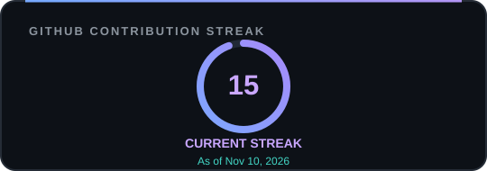

<!-- Premium GitHub Profile README for @the3zer0 -->

  

  
<strong>Thoughtful interfaces. Useful products. Continuous growth.</strong>

  
CSE Student&nbsp; · &nbsp;Web Developer&nbsp; · &nbsp;Bangladesh 🇧🇩

  
  
  

---

## About

I’m **Md Rahat Mahmud**, a CSE student and developer from **Bangladesh**. I build responsive web experiences with a focus on clear interfaces, practical features, and maintainable code.

- **Building:** React and Next.js applications with user-focused features
- **Exploring:** TypeScript, authentication, Python/Django, and databases
- **Improving:** Reusable components, project structure, and documentation
- **Outside the editor:** Video editing, content creation, and digital products

## Tech Stack

**Frontend & Languages**  

**Backend & Databases · Exploring**  

**Tools**  

## Selected Projects

| Project | Overview | Built with | |
|:--|:--|:--|:--:|
| **[BazarDor](https://github.com/the3zer0/Bazardor)** | Bengali market-price dashboard with category sorting, market comparisons, and authentication. | Next.js · TypeScript · Tailwind CSS · Better Auth | [Live](https://bazardor-azure.vercel.app) |
| **[FitLog](https://github.com/the3zer0/Fitlog-)** | Workout explorer with daily planning, saved workouts, and completion tracking. | Next.js · React · TypeScript · Tailwind CSS | [Live](https://fitlog-xi-ten.vercel.app) |
| **[Maowa.me](https://github.com/the3zer0/Maowa.me)** | Cinematic portfolio showcasing video editing, motion graphics, and visual storytelling. | React · Vite · JavaScript · Framer Motion · GSAP | [Live](https://maowa.me/) |
| **[Payoo — Wallet Demo](https://github.com/the3zer0/Payoo-app)** | Educational wallet simulation with transfers, bill payments, and transaction history. | HTML · CSS · JavaScript | [Live](https://payoomobileapp-orcin.vercel.app) |

Payoo is a learning project and is not a real financial service.

## GitHub Activity

  
  
    
  
   
  <a href="https://github.com/the3zer0">View my GitHub profile and contribution calendar</a>

## Let’s Connect

Open to learning, collaborating, and building useful things with other developers.

  <a href="https://rahattech.vercel.app">Portfolio</a>&nbsp; · &nbsp;
  <a href="https://www.linkedin.com/in/mahmud3zer0">LinkedIn</a>&nbsp; · &nbsp;
  <a href="mailto:mdayatmahmud.101@gmail.com">Email</a>
    
  

